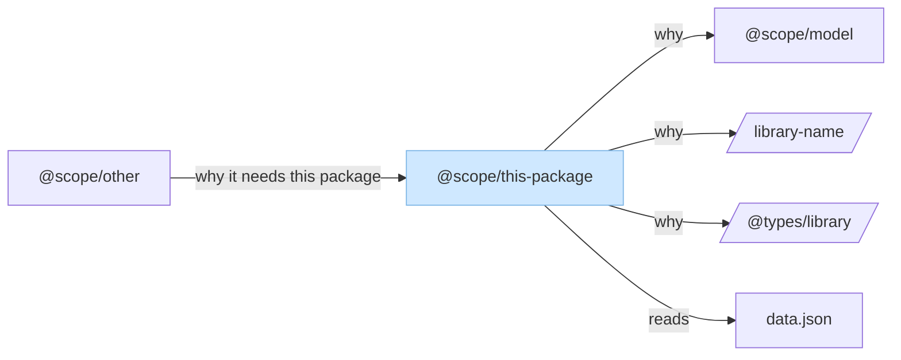
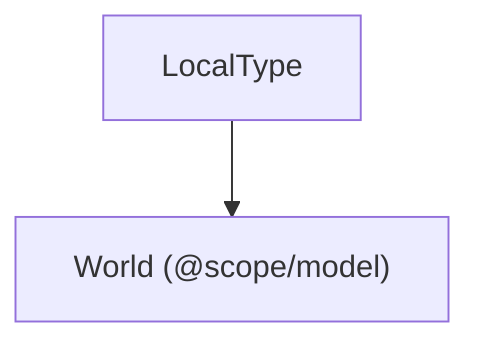
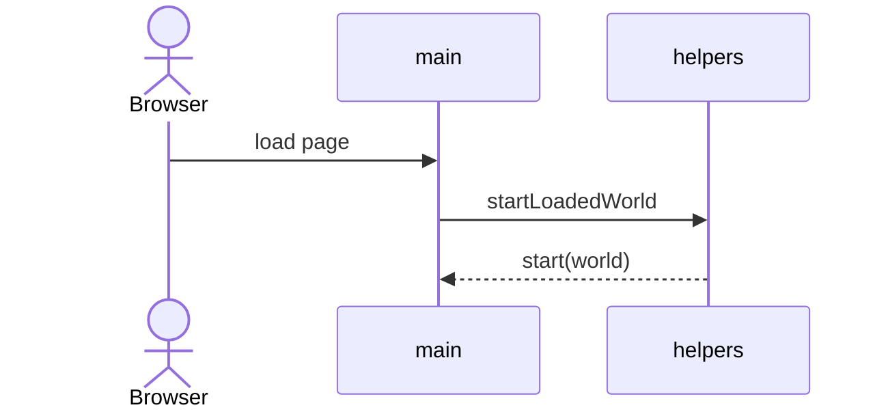

# Document a package

Write a design document for one package from the code as it is now. The document is the deliverable. `docs/viewer-design.md` is a finished example of the shape and tone. Match that shape. Do not copy its facts into another package.

## Inputs

| Input | Required | Meaning |
| --- | --- | --- |
| Package | Yes | Directory (`packages/viewer`), folder name (`viewer`), or `package.json` name (`@sw3d/viewer`). |
| Output path | No | Where to write. Default is `docs/<folder>-design.md`. `<folder>` is the package directory's basename, so `@sw3d/viewer` still writes `docs/viewer-design.md`. |

Resolve an output argument this way:

- Bare filename (`layout-notes.md`) goes under `docs/`.
- A path with a slash is relative to the repo root.
- An absolute path is used as given.

If the package cannot be resolved to one directory, stop and list the matches. Do not guess.

## Steps

Copy this checklist and complete it in order.

```
- [ ] 1. Resolve the package directory and the output path
- [ ] 2. If the output file exists, read it all
- [ ] 3. Read the package and its consumers
- [ ] 4. Create the file, or update it where the code disagrees
- [ ] 5. Check the document against the rules below
- [ ] 6. Report created or updated
```

### 1. Resolve the package

1. If the argument is an existing directory, that is the package root.
2. If `packages/<argument>/package.json` exists, use that directory.
3. If the argument starts with `@`, find the `package.json` whose `"name"` equals it.
4. Several matches: stop and list them.

Read the `"name"` field. That scoped name is the label on the main diagram node.

### 2. Read an existing document first

When the output file exists, read the whole file before editing.

- If it already has the three sections below, this is an update. Edit the drifted parts. Leave sentences that are still true.
- If it exists and is some other kind of document, stop and say so. Do not overwrite it.

### 3. Read the code

Read these, and skip `node_modules` and `dist`:

- `package.json` — `dependencies`, `devDependencies`, `exports`, `main`, `bin`
- `project.json` — targets and `dependsOn`
- The real entry. An empty `src/index.ts` means the entry is elsewhere (`index.html`, `src/main.ts`, a bin, an executor). Document that entry.
- Every source file that defines a type, class, or exported function. Read a test only when the implementation's contract is unclear.
- The repo, for consumers: imports of the package name, and `dependsOn` / copies of this package's build output. A package can be consumed as copied files (`dist`) rather than as a TypeScript import. Record that when you find it.

`docs/superpowers/` plans are not a source of truth. When a plan and the code disagree, the code wins.

Build three lists before writing:

1. **Outgoing.** Each direct dependency and devDependency, classified as runtime, build, test, or compile-time types, plus one sentence on why this package uses it.
2. **Incoming.** Each workspace package or host that runs or includes this package, plus data files this package fetches or writes as part of its contract.
3. **Components and flows.** The modules, classes, and named types, and the paths a caller or user can take through them.

### 4. Write or update

**Create** when the output file is absent. Use the template below.

**Update** when it is already a design doc:

- Change a sentence when the code disagrees with it.
- Add a dependency, type, component, or flow that the code has and the doc lacks.
- Remove a description of code that is gone.
- Keep the three-section structure and the diagram rules.
- Do not restyle accurate prose.

A devDependency that only serves another tool (a coverage provider used by the test runner) is mentioned in that tool's sentences. It does not get its own diagram node.

### 5. Check before finishing

- The file is at the resolved path.
- Sections, in order: opening summary, External dependencies, Components, Flows.
- The dependency diagram marks this package with `style <id> fill:#cfe8ff,stroke:#7eb6e6`.
- Every third-party library on that diagram is a parallelogram. Workspace packages, hosts, and data files are rectangles.
- Every direct dependency and devDependency appears under Outgoing, with a one- or two-sentence reason.
- Every consumer found in step 3 appears under Incoming. When there are none, the Incoming subsection says none were found.
- Every named type on the type diagram exists in the code you read.
- Flow names match real functions. A function you did not read is not described.
- On an update, accurate paragraphs are still there.

### 6. Report

Tell the user one of:

- `Created docs/<folder>-design.md.`
- `Updated <path>:` followed by a short list of what changed (added, corrected, removed). Name the section. When nothing in the code disagreed with the file, say that no changes were needed.

Do not paste the document into the chat.

## Document template

```markdown
# <Folder name, capitalized>

<What the package is, in two or three sentences. Name the entry file and what a caller or the runtime does with it.>

<One sentence or a small table naming the source modules and the role of each.>

## External dependencies

<dependency diagram>

<The light blue rectangle is this package. Parallelograms are third-party libraries. Arrows point from the thing that needs something to the thing it needs. Then say which nodes are incoming.>

### Outgoing

**<name>** (<runtime|build|test|compile>). <One or two sentences: what this package uses it for.>

### Incoming

**<name>**. <One or two sentences: how it uses this package. For a data file, say who writes it and what this package does with it.>

## Components

<One or two sentences on what the building blocks are. When there are no classes, say that behavior lives in functions.>

<type diagram>

<One sentence on private types or external types that appear in the diagram.>

### `<module, class, or file>`

<One sentence: its responsibility.>

| Type or function | Responsibility |
| --- | --- |
| `<name>` | <One sentence.> |

## Flows

### <Flow name>

<Who starts it, which components run, in what order, and the outcome. Use real function names.>

<sequence diagram for the primary flow only>
```

Add a `###` flow for each path that uses more than one component. Startup or the main request is the primary flow and gets the sequence diagram. Other flows stay prose. Use a numbered list when order matters. Add a second sequence diagram only when the order is hard to follow in prose.

## Diagram rules

### Dependencies



- The main package is a rectangle with that exact `style` line. The node id in `style` matches the node id in the diagram.
- A third-party library (an npm package that is not a workspace package) is a parallelogram: `id[/name/]`.
- A label that contains `/` or another character Mermaid treats as syntax goes in quotes inside the shape: `id[/"@types/node"/]`.
- A workspace package, a host such as the browser, and a data file are rectangles: `id["label"]`.
- Arrow direction is depender to dependee. Incoming consumers point at this package. Outgoing dependencies point away from it.
- The arrow label is a short verb phrase taken from the real use (reads types, bundles, copies dist).
- One node per direct dependency that is a library or workspace package, one node for this package, one node per incoming consumer, and a data-file node only when this package reads or writes that file as part of its contract.
- Do not draw transitive dependencies.

### Types



- `flowchart TB`. One rectangle per named type that other code in the package uses.
- Include a private type when another type depends on it. Otherwise describe it only in the table.
- Include an external type when a local type's fields use it. Label it with its source, as in `World (@scope/model)`.
- Arrow `A --> B` means A contains or depends on B.
- Leave constants off this diagram. Describe constant groups in the module table.

### Primary flow



Participants are the components from the Components section, plus the external actor that starts the flow. Messages use real function names.

## Language

- Present tense, short sentences.
- Name the file, type, or function.
- One to two sentences per dependency. One sentence per component responsibility.
- State the behavior the code has. Skip praise, hedging, and future ideas.
- A fact you could not point at in a file you opened does not go in the document.

## Gotchas

- An empty `index.ts` is not the entry. Find the file the runtime actually loads.
- Search for copied build output and `dependsOn`, not only `import` statements.
- `dependencies` and `devDependencies` are both outgoing. Label each as runtime, build, test, or compile.
- Plans under `docs/superpowers/` go stale. Re-read the source on every run, including updates.
- On an update, a wrong sentence is a bug in the doc. Fix that sentence. Do not rewrite the file to refresh the wording.
