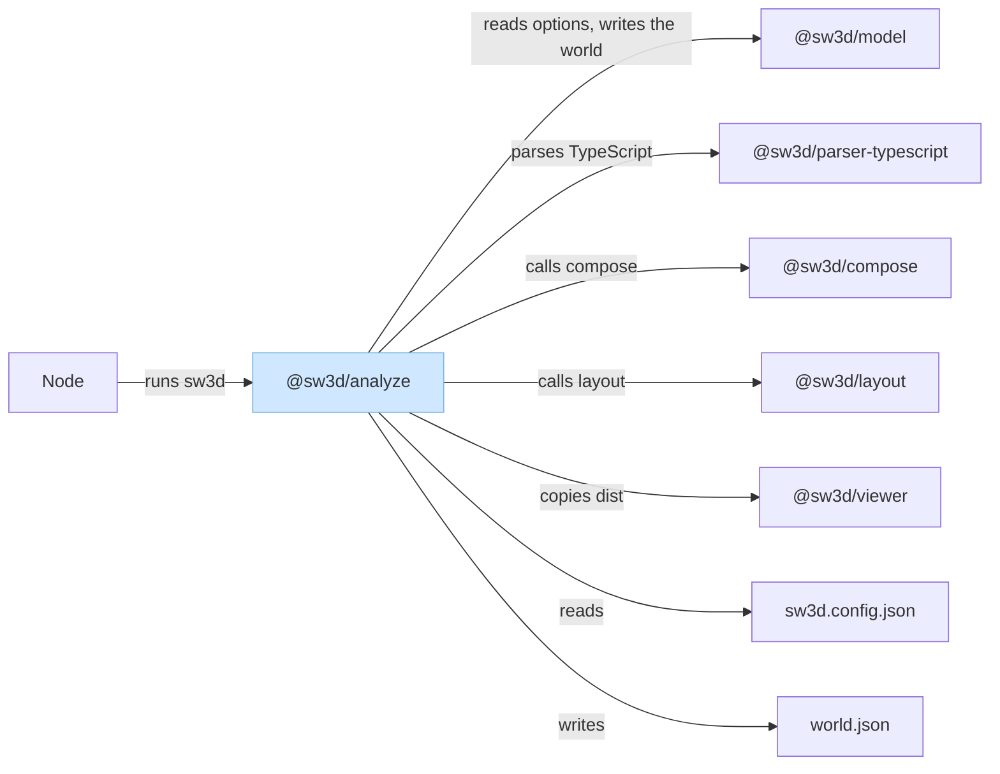
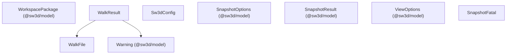
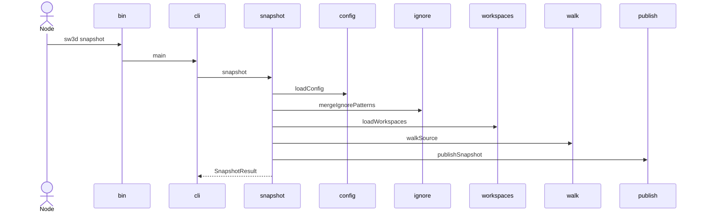
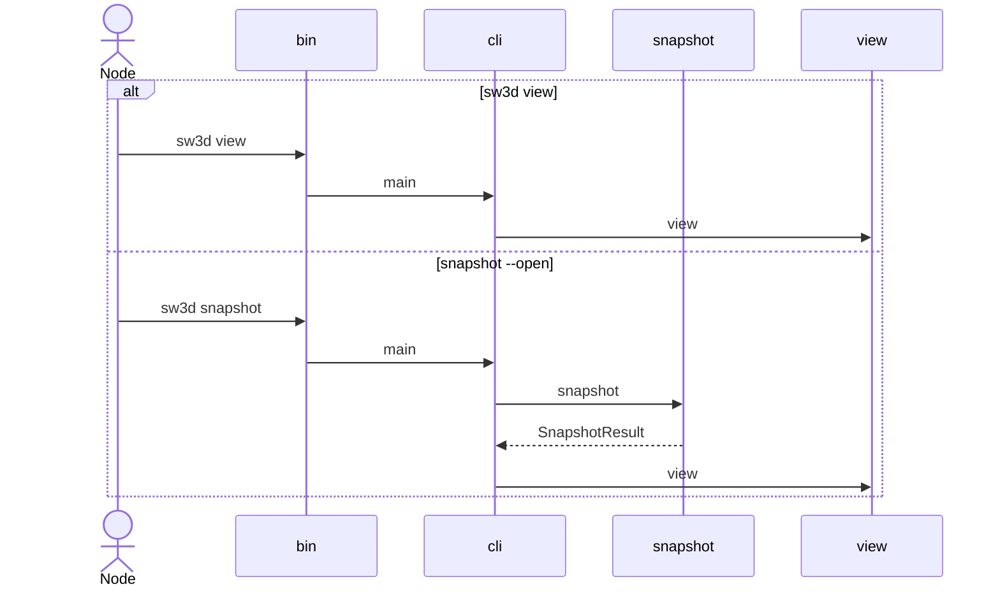

# Analyze

`@sw3d/analyze` is the `sw3d` command. `src/bin.ts` is the process entry: it calls `main` and exits with that code. `src/index.ts` is the library entry. It re-exports `snapshot`, `view`, workspace loading, the source walk, ignore matching, and `publishSnapshot`. The Nx build runs `tsc` and publishes `dist/bin.js` and `dist/index.js`. The build and test targets depend on `viewer:build`.

The source splits into these modules:

| Module          | Role                                                         |
| --------------- | ------------------------------------------------------------ |
| `bin.ts`        | Process entry. Calls `main` and exits.                       |
| `cli.ts`        | Parses `snapshot` and `view` arguments and runs them.        |
| `snapshot.ts`   | Walks a folder, builds a world, and publishes the snapshot.  |
| `config.ts`     | Reads `sw3d.config.json`.                                    |
| `ignore.ts`     | Merges ignore patterns and tests paths against them.         |
| `workspaces.ts` | Turns npm workspaces into `WorkspacePackage` values.         |
| `walk.ts`       | Walks the tree for `.ts` and `.tsx` files.                   |
| `publish.ts`    | Moves `world.json`, `index.html`, and `assets` into `--out`. |
| `view.ts`       | Serves a snapshot directory on localhost.                    |
| `fatal.ts`      | The `SnapshotFatal` error.                                   |

## External dependencies

The light blue rectangle is `@sw3d/analyze`. Parallelograms are third-party libraries. This package lists none, so the diagram has no parallelograms. Arrows point from the package that needs something to the thing it needs. Node is incoming. `sw3d.config.json` is read from the analyzed folder. `world.json` is written into the snapshot.

### Outgoing

`@sw3d/model` (runtime). The CLI fills `SnapshotOptions` and `ViewOptions`. The walk and workspace loader use `Warning` and `WorkspacePackage`. `snapshot` builds a `CodeGraph` and a `World`, then writes `serializeWorld(world)` to `world.json`.

`@sw3d/parser-typescript` (runtime). `snapshot` calls `createTypeScriptParser` and `parse`. The parser's `defaultIgnore` is `node_modules`, `.git`, `dist`, `build`, `coverage`, and `.nx`.

`@sw3d/compose` (runtime). `snapshot` calls `compose` with the graph and the workspace packages. `EmptySourceError` becomes a `SnapshotFatal` with the same message.

`@sw3d/layout` (runtime). `snapshot` calls `layout` on that city. The world's warnings are the layout warnings merged with the graph warnings.

`@sw3d/viewer` (build). It is not a `package.json` dependency. The analyze build and test targets depend on `viewer:build`. `snapshot` copies `packages/viewer/dist` (`index.html` and `assets`) into the snapshot. A missing build throws `SnapshotFatal("viewer build is missing; run nx build viewer")`.

### Incoming

**Node.** Runs `sw3d` from `dist/bin.js`. No other workspace package imports `@sw3d/analyze`.

`sw3d.config.json`**.** Optional. `loadConfig` reads `--config` when it is set, otherwise `<folder>/sw3d.config.json` when that file exists. A missing default file leaves the config null.

`world.json`**.** `snapshot` writes it next to the copied viewer files. The page in that directory fetches `./world.json`.

## Components

`SnapshotFatal` is the only class. The rest of the behavior lives in functions.

`CodeGraph` and `World` come from `@sw3d/model`. `snapshot` builds both and declares no local type for them. `ViewExtras` is private to the `view` call. `PackageRoot` and `Hit` stay inside `walk.ts` and `workspaces.ts`.

### `bin.ts`

The shebang entry. It calls `main(process.argv.slice(2))`, then `process.exit` with that code. A thrown error is printed and the process exits 1.

### `cli.ts`

Reads argv and runs one command.

| Function            | Responsibility                                                                                                                                                                                                    |
| ------------------- | ----------------------------------------------------------------------------------------------------------------------------------------------------------------------------------------------------------------- |
| `parseSnapshotArgs` | Requires one folder and `--out`. Accepts `--config`, repeated `--ignore`, and `--open`. An unknown flag throws `SnapshotFatal`.                                                                                   |
| `main`              | `snapshot` runs `snapshot` and, when `--open` is set, `view` on the output directory. `view` serves one directory. Any other command prints usage and returns 1. A caught error prints its message and returns 1. |

### `snapshot.ts`

Turns one folder into a snapshot directory.

| Function            | Responsibility                                                                                                    |
| ------------------- | ----------------------------------------------------------------------------------------------------------------- |
| `snapshot`          | Runs the pipeline and copies `packages/viewer/dist`, resolved from this file.                                     |
| `snapshotWithHooks` | Same pipeline. An optional `viewerDist` replaces that default path.                                               |
| `mergeWarnings`     | Private. Keeps the first warning for each path and message, then sorts by path and message with UTF-8 byte order. |

The folder must be a readable directory. `--out` must not be that folder, a path inside it, or a path that would make `world.json`, `index.html`, or `assets` point back into it.

### `config.ts`

Loads the optional JSON config.

| Function     | Responsibility                                                                                                            |
| ------------ | ------------------------------------------------------------------------------------------------------------------------- |
| `loadConfig` | Returns null when no file is configured and `sw3d.config.json` is absent. Otherwise parses the file and checks its shape. |

The object may contain `ignore` and `languages`. Each language entry may contain `useDefaults` and `ignore`. Any other key throws `SnapshotFatal`. `ignore` values must be arrays of strings. A missing file passed with `--config`, and a file that is not JSON, throw `SnapshotFatal`.

### `ignore.ts`

Merges pattern lists and decides whether a path is ignored. The last matching pattern wins. A pattern that starts with `!` un-ignores. A trailing `/` matches directories only. A leading `/` anchors the match to the path. A pattern with no `/` matches any single path segment. `*` and `?` do not cross `/`. `**` crosses directories.

| Type or function      | Responsibility                                                                                                                                                       |
| --------------------- | -------------------------------------------------------------------------------------------------------------------------------------------------------------------- |
| `Sw3dConfig`          | Optional root `ignore` list and a `languages` map.                                                                                                                   |
| `mergeIgnorePatterns` | Starts with the parser defaults unless `languages.typescript.useDefaults` is false, then appends root `ignore`, `languages.typescript.ignore`, and the CLI patterns. |
| `isIgnored`           | True when the last matching pattern ignores the traversal path or the canonical path, including a match on a parent directory.                                       |

Other language ids are accepted by `loadConfig` and unused here.

### `workspaces.ts`

Reads the folder's `package.json` into packages compose can own.

| Function                  | Responsibility                                                                                                                                                                                                                                |
| ------------------------- | --------------------------------------------------------------------------------------------------------------------------------------------------------------------------------------------------------------------------------------------- |
| `loadWorkspaces`          | No manifest, or a manifest without `workspaces`, returns one package whose path is empty. A `workspaces` array, or `{ packages: string[] }`, expands each pattern to directories that contain `package.json`.                                 |
| `selectWorkspacePackages` | Sorts by declared path. The same real path and name keeps the first hit. The same real path and a different name returns fatal `"disagreeing package name"`. Two hits with the same package name return fatal `"duplicate package name ..."`. |

A `..` segment that would leave the folder, a non-string workspace entry, a missing or invalid package manifest, and a missing package name each return a fatal `Warning` and no packages. `snapshot` throws `SnapshotFatal` with that message. Patterns may use `*`, `?`, and `**`.

### `walk.ts`

Collects source files under the workspace packages.

| Type or function | Responsibility                                                                    |
| ---------------- | --------------------------------------------------------------------------------- |
| `WalkFile`       | The stored path, using the package's declared path, and the real filesystem path. |
| `WalkResult`     | `included` files, `unreadable` warnings, and `outsideSymlinks` warnings.          |
| `walkSource`     | Walks from the folder. Records `.ts` and `.tsx` files. Skips `.d.ts`.             |

An ignored path is not entered. A symlink whose real path is outside the folder is an `outsideSymlinks` warning (`"symlink outside root"`) and is not followed. A directory inside a package that cannot be listed, and a source file that cannot be read, become `unreadable` warnings. The longest package root that contains a real path owns it. Ties on length pick the UTF-8-smaller declared path. Directory names are visited in UTF-8 order.

### `publish.ts`

Installs the three snapshot entries into `--out`.

| Function                  | Responsibility                                                                     |
| ------------------------- | ---------------------------------------------------------------------------------- |
| `publishSnapshot`         | Publishes `world.json`, `index.html`, and `assets` in that order.                  |
| `publishSnapshotWithHook` | Same install. `failAfter` throws after the named entry so a test can see rollback. |

When `--out` does not exist, the staging directory is renamed to it. When `--out` exists and is a directory, each entry is backed up, the staged entry is renamed into place, and a failure restores the backups. When `--out` exists and is not a directory, staging is removed and the function throws. After a successful install, staging and this transaction's backups are removed.

### `view.ts`

Serves one snapshot directory and waits until the server closes.

| Type or function | Responsibility                                                                                                                                             |
| ---------------- | ---------------------------------------------------------------------------------------------------------------------------------------------------------- |
| `ViewExtras`     | Optional `AbortSignal`, port, and `onListen` callback. The CLI passes none of these.                                                                       |
| `view`           | Rejects with `SnapshotFatal` unless the directory contains `index.html` and `world.json`. Listens on `127.0.0.1`. The default port is `0`. Prints the URL. |

A request is resolved under the directory and checked with `realpath`. A path outside the directory, a missing file, or a directory is 404. `.html`, `.js`, `.css`, `.json`, `.svg`, and `.map` set a content type. Any other extension is `application/octet-stream`. An aborted signal closes the server.

### `fatal.ts`

| Class           | Responsibility                                                                       |
| --------------- | ------------------------------------------------------------------------------------ |
| `SnapshotFatal` | An `Error` whose `name` is `SnapshotFatal`. `main` prints the message and returns 1. |

## Flows

### Take a snapshot

Node starts `bin.ts`. `main` handles `snapshot`. `parseSnapshotArgs` builds a `SnapshotOptions`, then `snapshot` runs.

1. `assertFolder` resolves the folder. `assertOutOutsideFolder` checks `--out`.
2. `loadConfig` reads the config. `createTypeScriptParser` supplies `defaultIgnore`. `mergeIgnorePatterns` builds the pattern list.
3. `loadWorkspaces` loads packages. A fatal warning throws `SnapshotFatal`.
4. `walkSource` collects files. Readable texts go to the parser. Unreadable `.ts` and `.tsx` paths stay as file warnings. Other unreadable paths stay as directory warnings.
5. Zero readable files and zero unreadable source files throws `SnapshotFatal("no included source files")`.
6. `parse` runs. Unreadable source paths that the parser did not return are added to `files`. `mergeWarnings` joins parser warnings, unreadable files, directory warnings, and outside symlinks.
7. `compose` builds the city. `EmptySourceError` becomes `SnapshotFatal`. `layout` adds poses and polylines. Warnings on the world are `mergeWarnings` of the layout warnings and the graph warnings. Each warning is printed to stderr as `path: message`.
8. A staging directory is created beside `--out`. The viewer `index.html` and `assets` are copied in. `serializeWorld` is written to `world.json`. `assertStaging` requires those three entries, a non-empty `assets` directory, and `version` `1`.
9. `publishSnapshot` installs staging into `--out`. A failure deletes staging. The return value is `{ outDir }` for the resolved `--out`.

When `--open` is set, `main` then calls `view` on that directory.

`createTypeScriptParser`, `parse`, `compose`, `layout`, and `serializeWorld` run after `walkSource` and before `publishSnapshot`.

### Serve a snapshot

`main` handles `view` by calling `view({ dir })` with the one directory argument. The same `view` call runs after a snapshot when `--open` is set. `view` checks for `index.html` and `world.json`, listens on `127.0.0.1`, prints the URL, and serves files until the process stops. The CLI does not pass an abort signal, so that promise stays pending.

