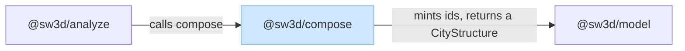
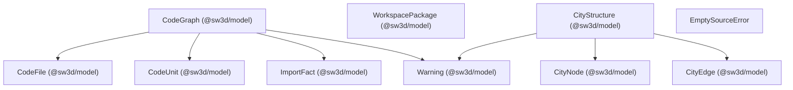
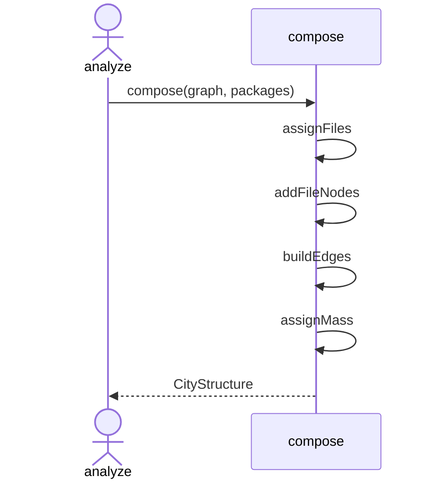

# Compose

`@sw3d/compose` turns a parsed code graph into a city. `compose` in `src/compose.ts` takes a `CodeGraph` and a list of `WorkspacePackage` values and returns a `CityStructure` of version `1`. `src/index.ts` re-exports `compose` and `EmptySourceError`. The Nx build runs `tsc` and publishes the entry as `dist/index.js` and `dist/index.d.ts`. Callers import `@sw3d/compose`.

The source is one module:

| Module | Role |
| --- | --- |
| `compose.ts` | Assigns files to packages, builds the city nodes and edges, and sets mass. |

`index.ts` re-exports that module. It defines nothing of its own.

## External dependencies

The light blue rectangle is `@sw3d/compose`. Parallelograms are third-party libraries. This package lists none, so the diagram has no parallelograms. Arrows point from the package that needs something to the thing it needs. `@sw3d/analyze` is incoming. `@sw3d/model` is outgoing.

### Outgoing

**`@sw3d/model`** (runtime). `compose` calls `cityId`, `districtId`, `buildingId`, `fileBoxId`, `symbolBoxId`, `portalId`, and `edgeId`. It reads a `CodeGraph` and `WorkspacePackage` list and returns a `CityStructure`. The compose build target depends on `^build`, so Nx builds model first.

### Incoming

**`@sw3d/analyze`**. `snapshot` calls `compose` with the graph it built from the parser. `EmptySourceError` becomes a `SnapshotFatal` carrying the same message. The city then goes to `layout`. The analyze build target depends on `^build`, which builds this package. Analyze tests load `@sw3d/compose` from `packages/compose/src/index.ts`.

## Components

`EmptySourceError` is the only class. The rest of the behavior lives in functions in `compose.ts`.

`compose.ts` names its working nodes `CityNode`, a `Node` without `pose`, and its working edges `CityEdge`, an `Edge` without `points`. The returned `CityStructure` stores those values. `EmptySourceError` has no model fields.

### `compose.ts`

Groups source files into districts, hangs folders and symbols under them, and rolls imports up into roads and portals.

| Type or function | Responsibility |
| --- | --- |
| `EmptySourceError` | Thrown when no graph file belongs to a package. The message is "No included source files remain after ignore and workspace ownership". |
| `compose` | Builds the city node, one district per owning package, the folder and file nodes, the edges, and the masses. Returns version `1` with the graph's name and warnings. |
| `assignFiles` | Groups file paths by `ownerOf`. A file with no owner is left out. |
| `ownerOf` | Picks the package with the longest path that contains the file. Equal lengths pick the UTF-8-smaller path. |
| `isInsidePackage` | An empty package path contains every file. Any other package contains a file whose path equals it or starts with that path plus `/`. |
| `buildingPaths` | The folder chain under the package, after the file name is removed. A leading `src` segment is skipped. |
| `addFileNodes` | No units: a file box. One unit: a symbol box on the current parent. Two or more: a building for the file, then one symbol box per unit. Returns the anchor id. |
| `symbolBox` | A box id from `symbolBoxId`, named with the unit, `unitKind` set to the unit kind, mass 1. |
| `groupUnits` | Groups `CodeUnit` values by `path`. |
| `buildEdges` | For each city, district, and building, rolls imports up to a road or a portal edge on that container. |
| `directChild` | Walks parents from an anchor and returns the node whose parent is the container. |
| `unreadableFiles` | Paths of warnings whose message starts with `unreadable`. |
| `assignMass` | A box is 1. A portal is 0. Every other node is the sum of its non-portal children. |
| `compareUtf8` | Private. Orders strings by UTF-8 bytes through `Buffer.compare`. |

The city node uses `cityId(graph.name)`, an empty path, and no parent. A district uses `districtId(pkg.path)`, the package name in `packageName`, and the graph name when the package path is empty. Otherwise the district name is the path's basename. Folder buildings, the multi-unit file building, and a file box are named with that basename. A symbol box is named with the unit. Folder buildings and the multi-unit file building use `buildingId`. A file box uses `fileBoxId` and `unitKind: "file"`. Symbol boxes under one file are ordered by unit name. Nodes are then sorted by path, then id. Edges are sorted by parent, from, to, then kind. Warnings are sorted by path, then message.

## Flows

### Compose a city

`@sw3d/analyze` calls `compose(graph, packages)`. When `assignFiles` keeps no paths, `compose` throws `EmptySourceError` and analyze rethrows that message as `SnapshotFatal`.

Otherwise `compose` does this:

1. Create the city node.
2. Walk owning package paths in UTF-8 order. Each package with at least one file becomes a district under the city.
3. Walk that district's files in UTF-8 order. `buildingPaths` adds any missing folder buildings, parented on the district or on the previous folder. `addFileNodes` records the file's anchor.
4. `buildEdges` adds roads, portal nodes, and portal edges.
5. `assignMass` writes every `mass`.
6. Sort nodes, edges, and the copied warnings.
7. Return `{ version: 1, name: graph.name, nodes, edges, warnings }`.

`buildEdges` visits containers in the order the nodes were created. For each import fact:

1. Skip it when `fromFile` is in `unreadableFiles`, when that file has no anchor, or when `directChild` cannot place the anchor under this container.
2. An external target counts 1 toward the pair of that direct child and `target.name`.
3. An internal target counts 1 toward the pair of direct children when both anchors resolve under this container and the children differ.
4. Each road pair becomes one `edgeId` of kind `road`, weighted by that count.
5. Each external name becomes one portal node, `portalId(container.id, name)`, parented on the container, with an empty path and mass 0. Each child that imports it gets a portal edge of that weight.

A warning that starts with `unreadable` drops that file's imports. The warning itself stays on the returned city. A file that no package owns never becomes a node.
