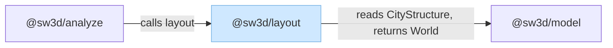
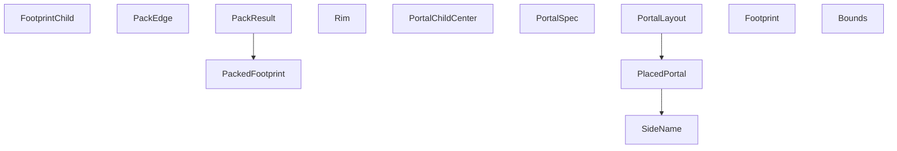
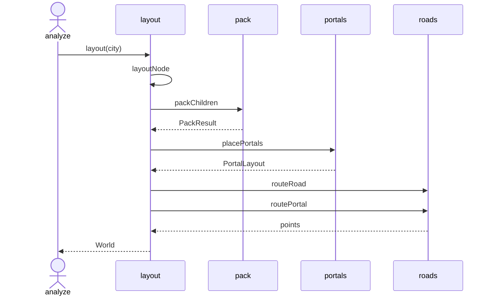

# Layout

`@sw3d/layout` places a code city. `layout` in `src/layout.ts` takes a `CityStructure` and returns a `World` whose nodes have poses and whose edges have street polylines. `src/index.ts` re-exports that function. The Nx build runs `tsc` and publishes the entry as `dist/index.js` and `dist/index.d.ts`. Callers import `@sw3d/layout`.

The source splits into four modules:

| Module | Role |
| --- | --- |
| `layout.ts` | Walks the city from the root and writes poses, mass, and routes. |
| `pack.ts` | Orders courtyard children and packs them into rows. |
| `portals.ts` | Places portal markers along the courtyard rim. |
| `roads.ts` | Routes a road or a portal path through walkable cells. |

`index.ts` re-exports `layout` only.

## External dependencies

The light blue rectangle is `@sw3d/layout`. Parallelograms are third-party libraries. This package lists none, so the diagram has no parallelograms. Arrows point from the package that needs something to the thing it needs. `@sw3d/analyze` is incoming. `@sw3d/model` is outgoing.

### Outgoing

**`@sw3d/model`** (runtime). `layout` takes a `CityStructure` and returns a `World` of version `1`. The import is type-only. City nodes and edges arrive without poses or polylines. The returned world adds both. The layout build target depends on `^build`, so Nx builds model first.

### Incoming

**`@sw3d/analyze`**. `snapshot` calls `layout` on the `CityStructure` from `compose`, then merges that world's warnings with the graph warnings before `serializeWorld`. The analyze build target depends on `^build`, which builds this package. Analyze tests load `@sw3d/layout` from `packages/layout/src/index.ts`.

## Components

The package has no classes. Behavior lives in functions. The named types below are the footprints, rims, and routes those functions pass around.

`CityStructure` and `World` come from `@sw3d/model`. `layout` reads a city and returns a world. `LocalLayout` is private to `layout.ts`. `roads.ts` keeps private `Cell`, `State`, and `SideName` types. `STREET`, `CLEARANCE`, and `BAND` are constants, so they stay off this diagram.

### `layout.ts`

Turns one city into a world, courtyard by courtyard, children before parents.

| Type or function | Responsibility |
| --- | --- |
| `LocalLayout` | Private size plus the placed nodes and edges of one subtree. |
| `layout` | Finds the node whose `parentId` is null, lays that subtree out, sorts the result, and returns `{ version: 1, name, nodes, edges, warnings }`. |
| `layoutNode` | Private. A box becomes a 10 by 10 footprint, 8 units tall, with mass 1. A portal throws. A city, district, or building packs its children, places portals, routes edges, and records its own footprint. |
| `toNode` | Private. Copies identity onto a world node, rounds the pose, and copies `unitKind` and `packageName` when the city node has them. |
| `pushLayoutEdge` | Private. Copies an edge and stores the rounded polyline. |
| `shift` | Private. Moves a subtree by `dx` and `dz`. A zero move returns the same layout. |

A courtyard's width and depth are the packed content, plus 20, plus the portal padding. Its height is `max(8, 8 * sqrt(mass))`, rounded. Mass is the sum of the child roots' masses. The courtyard node itself sits at `x: 0`, `z: 0`. Each child subtree is shifted by the content offset plus its packed origin. Sorting uses UTF-8 byte order: nodes by path then id, edges by parent, from, to, then kind, warnings by path then message.

### `pack.ts`

Decides the order and the row packing of one courtyard's district, building, and box children.

| Type or function | Responsibility |
| --- | --- |
| `STREET` | The gap between footprints, 8. |
| `FootprintChild` | One child to pack: id, path, kind, width, and depth. |
| `PackEdge` | A road or portal link with `from`, `to`, and `weight`. |
| `PackedFootprint` | A child origin and size after packing. |
| `PackResult` | The chosen id order, the placements, and the content width and depth. |
| `orderChildren` | Drops portals. Seeds the child with the strongest total road weight, then repeatedly appends the remaining child with the strongest weight into the placed set. Ties break by path, then id. |
| `targetRowWidth` | Square root of the summed child area. |
| `packRows` | Places children left to right. Starts a new row when the next child would push the row past the target width. |
| `squaredRoadCost` | Adds the squared center distance once for each undirected road whose weight is positive. |
| `packChildren` | Orders the children, then swaps grid-neighbor pairs while a swap lowers `squaredRoadCost` and the street gaps still hold. |
| `rimPerimeter` | `2 * (contentWidth + contentDepth + 2 * padding + 20)`. |
| `paddingFor` | Returns 0 when there are no portals. Otherwise grows padding by 4 until the rim is at least `separation` per portal. |

Road weights are undirected. A self-link, a portal edge, and an endpoint outside the child set are ignored. Two footprints must keep a gap of at least `STREET` on one axis. Overlap fails that check. A grid neighbor is a pair separated by exactly `STREET` on one axis whose other axes overlap.

### `portals.ts`

Sets portal markers on the centerline of the courtyard rim and rounds coordinates.

| Type or function | Responsibility |
| --- | --- |
| `SideName` | `north`, `east`, `south`, or `west`. North is the high-z side. |
| `Rim` | The rim rectangle and its center. |
| `PortalChildCenter` | A packed child's center, used to aim a portal. |
| `PortalSpec` | A portal id, name, and the child ids that link to it. |
| `PlacedPortal` | A marker center, side, and arc length along the rim. |
| `PortalLayout` | The starting padding, the padding actually used, the separation, the content offset, and the placed markers. |
| `roundCoord` | Throws `Error("coordinate is not finite")` when the value is not finite. Otherwise rounds to two decimal places, half away from zero, and returns `0` for a rounded zero. |
| `rimOf` | Builds the rim. The inset from the content is `5 + padding / 2`. |
| `nearestSide` | Picks the closest side to a point. An equal distance keeps the earlier side in north, east, south, west order. |
| `intersectRim` | Casts a ray from the rim center. A zero direction hits the middle of the north edge. A corner hit returns that corner. |
| `pointOnRim` | Walks an arc from the middle of the north edge, eastward, and wraps around the perimeter. |
| `markersClear` | True when every pair of 8 by 8 marker boxes has a gap of at least `0.02` on one axis. |
| `placePortals` | Packs markers along the rim. An empty list returns padding 0, separation 12, and content offset 10. |

### `roads.ts`

Finds a polyline on a 2-unit grid. A cell is walkable when it lies inside the courtyard and its 2 by 2 square misses every footprint.

| Type or function | Responsibility |
| --- | --- |
| `Footprint` | An obstacle rectangle: origin, width, and depth. |
| `Bounds` | The courtyard width and depth the grid must stay inside. |
| `routeRoad` | Searches a path between the closest pair of walkable border cells on the source and the target. |
| `routePortal` | Aims at the band cell nearest the marker, then searches a path that finishes on the exit side of the outer band. |
| `routeSearch` | Private A* over steps of 2. The path points are cell centers. Equal cost keeps the earlier candidate. Throws `Error("no street path")` when the goal is unreachable. |

The outer band is the 10 units inside each courtyard edge. Portal search may leave that band until it first steps onto the exit side, and after that it stays in the band. Border cells are the walkable cells just outside a footprint, ordered by z then x. The chosen pair is the shortest squared distance, then the smaller start and goal coordinates.

## Flows

### Lay out a city

`@sw3d/analyze` calls `layout` with the city from `compose`. A city with no root throws `Error("CityStructure has no root node")`. A city node nested under another node throws. `layoutNode` on a portal throws because the parent places that marker.

For a box, `layoutNode` returns one node and no edges. For a city, district, or building it does this:

1. Split children into courtyard children (district, building, box) and portals.
2. Call `layoutNode` on each courtyard child.
3. `packChildren` places those children.
4. `placePortals` sets the rim markers. The content offset is `10 + padding / 2`.
5. `shift` moves each child subtree to its packed origin.
6. Add each portal as an 8 by 8 by 8 node of mass 0, centered on its marker.
7. A road edge calls `routeRoad`. A portal edge calls `nearestSide` for the source center, then `routePortal`. Both receive the packed child footprints, not the portal boxes.
8. Append the courtyard node at the origin with the summed mass.

`layout` then sorts nodes, edges, and warnings and returns the world.

A box returns before those calls. A road edge calls `routeRoad`. A portal edge calls `routePortal`.

### Place portals

`layoutNode` calls `placePortals`. With no portals, that function returns immediately. Otherwise:

1. `paddingFor` picks a starting padding so `rimPerimeter` is at least 12 per portal.
2. `rimOf` builds the rim. Each portal's desired arc is the rim hit from the center toward the average of its `from` children. No such child, or an average within one unit of the rim center, uses arc 0.
3. Sort portals by arc, then name, then id. Pack the arcs so each one sits at least `separation` after the previous arc and not before its own desired arc.
4. When the packed arcs no longer fit the perimeter, add 4 to the padding and repeat.
5. `pointOnRim` turns each arc into a center. When `markersClear` fails, add 2 to the separation, grow the padding until the perimeter can hold it, and repeat.
6. Return the starting padding, the padding used, the separation, `contentOffset`, and the markers.

The loop throws `Error("portal packing did not terminate")` after 10000 rounds.
