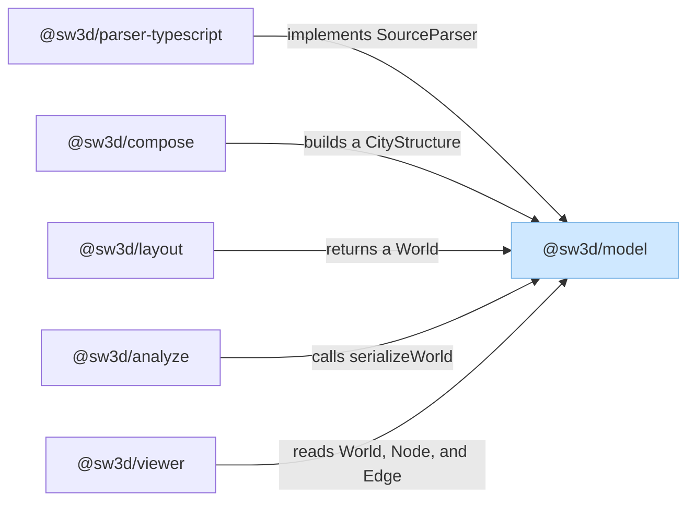
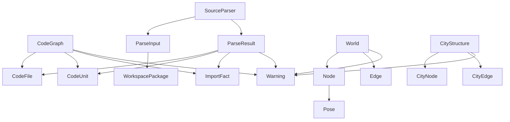
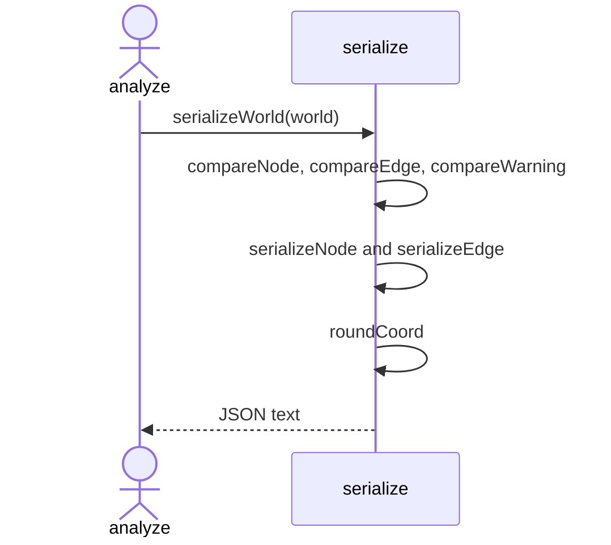

# Model

`@sw3d/model` is the shared contract for a code city: the parsed graph, the city before layout, and the laid-out world. Callers import `@sw3d/model`. `src/index.ts` re-exports the types, the id functions, and `serializeWorld`. The Nx build runs `tsc` and publishes that file as `dist/index.js` and `dist/index.d.ts`. Callers own every file read and write. This package returns strings and id values.

The source splits into three modules:

| Module | Role |
| --- | --- |
| `types.ts` | Interfaces for the graph, the parser, the city, the world, and the snapshot CLI. No behavior. |
| `ids.ts` | Length-prefixed id strings for nodes and edges. |
| `serialize.ts` | Canonical JSON text for one `World`. |

`index.ts` re-exports those three. It defines nothing of its own.

## External dependencies

The light blue rectangle is `@sw3d/model`. Parallelograms are third-party libraries. This package lists none, so the diagram has no parallelograms. Arrows point from the package that needs something to the thing it needs. `@sw3d/parser-typescript`, `@sw3d/compose`, `@sw3d/layout`, `@sw3d/analyze`, and `@sw3d/viewer` are incoming.

### Outgoing

None were found. `packages/model/package.json` has no `dependencies` and no `devDependencies`.

### Incoming

**`@sw3d/parser-typescript`**. `createTypeScriptParser` returns a `SourceParser`. Its `parse` method takes a `ParseInput` and returns a `ParseResult`. `parseFile` sets each `CodeUnit.id` with `symbolBoxId`. `resolveSpecifier` matches a specifier against `WorkspacePackage.name`. The package build target depends on `^build`, so Nx builds model first.

**`@sw3d/compose`**. `compose` takes a `CodeGraph` and a `WorkspacePackage` list and returns a `CityStructure` of version `1`. It mints ids with `cityId`, `districtId`, `buildingId`, `fileBoxId`, `symbolBoxId`, `portalId`, and `edgeId`. The package build target depends on `^build`.

**`@sw3d/layout`**. `layout` takes that `CityStructure` and returns a `World` of version `1`. Each city node becomes a `Node` with a `Pose`. Each city edge becomes an `Edge` with a polyline. The package build target depends on `^build`.

**`@sw3d/analyze`**. `parseSnapshotArgs` returns a `SnapshotOptions`. `loadWorkspaces` and `walkSource` use `WorkspacePackage` and `Warning`. `snapshot` builds a `CodeGraph`, runs compose and layout, and writes `serializeWorld(world)` to `world.json` in the snapshot directory. `view` takes a `ViewOptions`. The analyze build target depends on `^build`.

**`@sw3d/viewer`**. Imports `World`, `Node`, and `Edge` as types. Node pose, kind, parent, name, and path become courtyard footprints. Edge kind, weight, endpoints, and points become the lines on the ground. The page loads those values from `world.json`, which analyze wrote with `serializeWorld`.

## Components

The package has no classes. Behavior lives in the functions in `ids.ts` and `serialize.ts`. The named types are the values those functions and the other packages pass around.

`ImportFact.target` is an inline internal-or-external union. `Edge.points` is an inline list of `{ x, z }` points. `ParseInput.files` is an inline list of `{ path, text }`. `SnapshotOptions`, `SnapshotResult`, and `ViewOptions` contain no other named types, so they stay off the diagram.

### `types.ts`

Holds the interfaces the rest of the workspace shares. Nothing in this file runs.

| Type | Responsibility |
| --- | --- |
| `Warning` | A `path` and a `message`. Graphs, parse results, cities, and worlds all carry a list of these. |
| `WorkspacePackage` | One workspace package: its `path` and `name`. |
| `CodeFile` | A source file path on the graph. |
| `CodeUnit` | One class, interface, type, or enum: `id`, `kind`, `name`, and `path`. |
| `ImportFact` | One import: `fromFile`, the raw `specifier`, and a target that is either an internal `file` or an external package `name`. |
| `CodeGraph` | The named graph compose reads: files, units, imports, and warnings. |
| `ParseInput` | What a parser receives: repo `root`, file texts, `includedPaths`, and workspace packages. |
| `ParseResult` | What a parser returns: files, units, imports, and warnings. `files` is `CodeGraph["files"]`. |
| `SourceParser` | A parser plugin: string `id`, `defaultIgnore` patterns, and `parse(input)`. |
| `Pose` | A footprint on the ground: `x`, `z`, `width`, `depth`, and `height`. |
| `Node` | One placed city object. `kind` is city, district, building, box, or portal. Optional `unitKind` is file, class, interface, type, or enum. Optional `packageName` names a district's package. `mass` and `pose` are required. |
| `Edge` | One placed link. `kind` is road or portal. `parentId` is the courtyard that owns it. `from`, `to`, `weight`, and `points` describe the line. |
| `World` | The document the viewer loads. `version` is `1`. It holds `name`, placed `nodes`, placed `edges`, and `warnings`. |
| `CityNode` | The same identity fields as `Node`, before layout adds a `Pose`. |
| `CityEdge` | The same link fields as `Edge`, before layout adds `points`. |
| `CityStructure` | The city compose returns and layout consumes. `version` is `1`. Nodes and edges are the unplaced forms. |
| `SnapshotOptions` | CLI inputs for a snapshot: `folder`, `out`, optional `config`, `ignore` patterns, and `open`. |
| `SnapshotResult` | The directory a snapshot wrote: `outDir`. |
| `ViewOptions` | CLI input for serving a snapshot: `dir`. |

### `ids.ts`

Builds stable id strings. Each component is its UTF-8 byte length, a colon, and the raw text, joined with no separator. `Buffer.byteLength` measures the length.

| Function | Responsibility |
| --- | --- |
| `len` | Private. Returns `${byteLength}:${component}` for one piece. |
| `cityId` | `city:` plus the length-prefixed basename. |
| `districtId` | `district:` plus the length-prefixed package path. An empty path is `district:0:`. |
| `buildingId` | `building:` plus the length-prefixed path. |
| `fileBoxId` | `box:` plus the length-prefixed file path. |
| `symbolBoxId` | `box:` plus the length-prefixed file path and the length-prefixed symbol name. |
| `portalId` | `portal:` plus the length-prefixed parent id and the length-prefixed package name. |
| `edgeId` | `edge:` plus the length-prefixed parent id, from id, and to id. |

### `serialize.ts`

Turns a `World` into pretty-printed JSON. Sorting uses `Buffer.compare` on UTF-8 bytes. The input arrays, poses, and warning order stay as the caller left them.

| Function | Responsibility |
| --- | --- |
| `serializeWorld` | Copies nodes, edges, and warnings, sorts those copies, rounds coordinates, and returns the JSON text plus a trailing newline. |
| `compareNode` | Private. Orders nodes by `path`, then `id`. |
| `compareEdge` | Private. Orders edges by `parentId`, then `from`, then `to`, then `kind`. |
| `compareWarning` | Private. Orders warnings by `path`, then `message`. |
| `serializeNode` | Private. Writes `id`, `kind`, `name`, `parentId`, and `path`, then `unitKind` and `packageName` when the node has them, then `mass` and the rounded `pose`. |
| `serializeEdge` | Private. Writes `id`, `kind`, `parentId`, `from`, `to`, `weight`, and the rounded `points`. |
| `roundCoord` | Private. Throws `Error("coordinate is not finite")` when a coordinate is not finite. Otherwise rounds to two decimal places, half away from zero, and returns `0` when the rounded value is zero. |

## Flows

### Serialize a world

`@sw3d/analyze` imports `serializeWorld` from `@sw3d/model`. `index.ts` re-exports the function from `serialize.ts`. `snapshot` calls it with the `World` returned by `layout`, then writes the string to `world.json`.

`serializeWorld` does this in order:

1. Copy `nodes` and sort the copy with `compareNode`.
2. Copy `edges` and sort the copy with `compareEdge`.
3. Copy `warnings` and sort the copy with `compareWarning`.
4. `serializeNode` rounds each pose field with `roundCoord`. It includes `unitKind` and `packageName` only when those fields are present on the node.
5. `serializeEdge` rounds each point with `roundCoord`.
6. Return `JSON.stringify` of `{ version, name, nodes, edges, warnings }` with a two-space indent, then a final newline.

A non-finite pose or point coordinate throws during rounding. The same world produces the same text on a second call.

