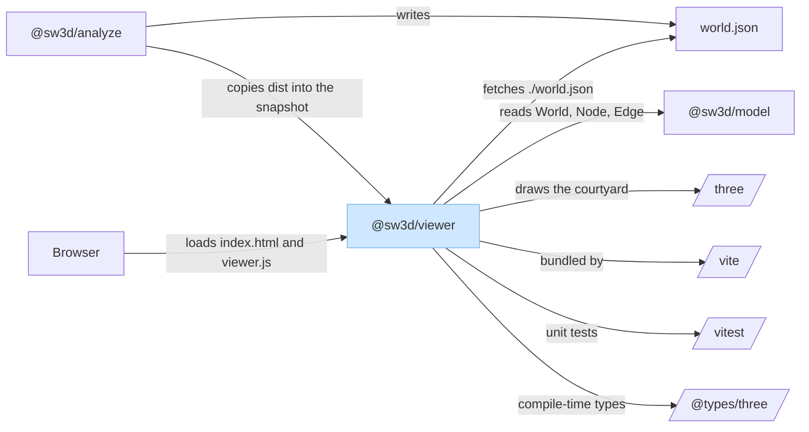
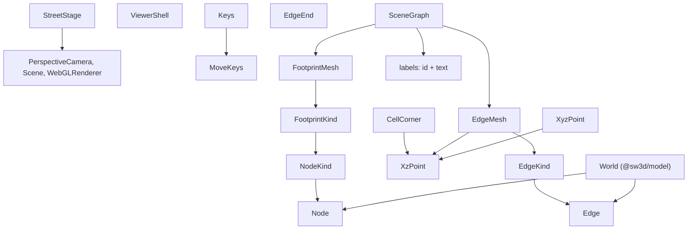
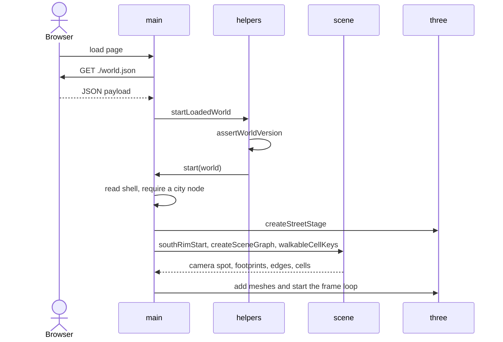

# Viewer

`@sw3d/viewer` is a browser app. Vite builds `index.html` and `src/main.ts` into `packages/viewer/dist`. The page fetches `./world.json` and draws one courtyard of a code city at a time. `src/index.ts` exports nothing. Other packages use the built files.

The source splits into four modules:

| Module | Role |
| --- | --- |
| `types.ts` | Shared constants and small types. No behavior. |
| `helpers.ts` | World queries, version check, and walk math. No DOM and no Three.js. |
| `scene.ts` | Courtyard geometry and walkable cells for one parent node. No Three.js. |
| `main.ts` | Page startup, Three.js drawing, input, and the frame loop. |

`index.html` is the page shell those modules read.

## External dependencies

The light blue rectangle is `@sw3d/viewer`. Parallelograms are third-party libraries. Arrows point from the package that needs something to the thing it needs. `@sw3d/analyze` and the browser are incoming. Everything to the right of the viewer is outgoing.

### Outgoing

**`@sw3d/model`** (runtime). The viewer reads a `World`: its `version`, `nodes`, and `edges`. Node pose, kind, parent, name, and path become footprints and walk limits. Edge kind, weight, endpoints, and polyline become the lines on the ground. That finished document is the only model data this package uses.

**`three`** (runtime, `0.170.0`). `main.ts` uses it for the WebGL renderer, scene, perspective camera, lights, box meshes, raycaster, and frame clock. `scene.ts` and `helpers.ts` stay free of Three.js so layout math can be tested without a GPU.

**`vite`** (build). Bundles the page into `dist/index.html` and `dist/assets/viewer.js`. `base: "./"` makes those asset URLs relative, so the same files work when analyze copies them into a snapshot directory.

**`vitest`** and **`@vitest/coverage-v8`** (test). Run the unit tests for `helpers.ts` and `scene.ts`. The Nx `test` target invokes Vitest through the local executor in `packages/viewer/executors`.

**`@types/three`** (compile). TypeScript definitions for the `three` import. They are not shipped in the browser bundle.

### Incoming

**`@sw3d/analyze`**. It does not import viewer source. `snapshot` copies `packages/viewer/dist` (`index.html` and `assets/`) into the output directory and writes `world.json` next to them. `view` serves that directory over HTTP. The analyze test and build targets depend on `viewer:build`.

**Browser.** Loads the built page and runs `main.ts`. The page then requests `./world.json` from the same directory.

**`world.json`.** The document the page draws. Analyze writes it with the model serializer. The viewer only checks that `version` is `1` and then treats the payload as a `World`.

## Components

The package has no classes. Behavior sits in functions. The named types below are the data those functions pass around.

`StreetStage` is the only viewer type that depends on Three.js. `CellCorner` is private to `helpers.ts`. `SceneGraph.labels` is an inline `{ id, text }` list, not its own named type.

### `types.ts`

Holds the numbers, key names, colors, DOM selectors, and small structures the other modules share.

| Type or constant group | Responsibility |
| --- | --- |
| `XzPoint`, `XyzPoint` | A ground position, and the same position with height. |
| `MoveKeys`, `Keys` | Which WASD keys are held. `Keys` adds sprint. |
| `ViewerShell` | The DOM nodes `main.ts` reads and updates: canvas, detail panel, and breadcrumb. |
| `StreetStage` | The Three.js renderer, scene, and camera for one running view. |
| `NodeKind`, `EdgeKind` | The kind strings stored on a world document: city, district, building, box, portal, road. |
| `FootprintKind` | Node kinds drawn as courtyard blocks. The city is the ground, so it is left out. |
| `EdgeEnd` | Which end of an edge a panel row names: `to` for "depends on", `from` for "used by". |
| Movement and camera constants | Walk and sprint speed, eye height, field of view, look sensitivity, pitch limit, and the longest frame step. |
| Courtyard constants | Glide duration, overhead camera height, street cell size, edge thickness, and colors. |
| `WORLD_VERSION`, `WORLD_URL` | The document version this build can load, and the relative URL it fetches (`./world.json`). |
| `VIEW_ELEMENT`, `MOVE_KEY`, `ACTION_KEY` | CSS selectors and keyboard keys, so those strings live in one place. |

### `helpers.ts`

Answers questions about a `World` and about where a step on the ground is allowed to land.

| Function | Responsibility |
| --- | --- |
| `startLoadedWorld` | Reads `version` from the fetched JSON. On a match, calls `start` with the payload as a `World`. On a mismatch, shows the version message and stops. |
| `assertWorldVersion` | Throws when `version` is not `WORLD_VERSION`. |
| `breadcrumb` | Walks `parentId` links from the current courtyard up to the city and returns the names, root first. |
| `incidentEdges` | Splits edges that touch a node into `dependsOn` (this node is `from`) and `usedBy` (this node is `to`). |
| `enterTarget` | Returns a hit id only when that node is a district or building and a direct child of the current courtyard. |
| `walkDirection` | Turns the camera's horizontal facing plus WASD into one normalized ground vector. Returns null when no move key is held. |
| `resolveWalk` | Keeps a proposed ground position when it sits inside a walkable cell. Otherwise snaps it to the nearest walkable cell center. |
| `clampToWalkable` | Picks that nearest cell center. Throws when the walkable set is empty. |
| `CellCorner` | Private parse of a `"x,z"` cell key into the cell's minimum corner. |

`scene.ts` calls `clampToWalkable` when placing the camera just outside a courtyard it is leaving.

### `scene.ts`

Turns one parent node of a `World` into data `main.ts` can draw and walk. It does not create Three.js objects.

| Type or function | Responsibility |
| --- | --- |
| `FootprintMesh` | One child block: id, kind, name, path, and the pose box (x, z, width, depth, height). |
| `EdgeMesh` | One dependency line in the current courtyard: endpoints, kind, weight, and the ground polyline. |
| `SceneGraph` | The footprints, edges, and label texts for a single `parentId`. |
| `createSceneGraph` | Collects children of `parentId` as footprints (skipping a nested city) and edges whose `parentId` matches. Fills `labels` with each child's name. |
| `walkableCellKeys` | Every `CELL_SIZE` square inside the parent pose that does not overlap a district, building, or box. Portals stay walkable. Keys are `"x,z"` of the cell's minimum corner. |
| `southRimStart` | Eye-height point on the southernmost walkable cell, closest to the parent's horizontal center. Used when entering a courtyard. |
| `outsideChildSpot` | Eye-height point just south of a child, snapped onto a walkable cell of the parent. Used when leaving that child. Falls back to `southRimStart` when the child is missing or the parent has no walkable cells. |

`main.ts` draws `footprints` and `edges`. It does not draw `labels`.

### `main.ts`

Owns the running session after the world has loaded. It is the only module that touches the DOM and Three.js.

| Piece | Responsibility |
| --- | --- |
| `boot` | Fetches `WORLD_URL`. Shows a message and stops on a failed response or a network error. Otherwise hands the JSON to `startLoadedWorld`. |
| `readViewerShell` | Looks up the elements in `index.html` and fails if one is missing or the wrong element type. |
| `createStreetStage` | Builds the renderer, dark scene, perspective camera, ambient light, and sun. |
| `start` | Session state: current courtyard (`parentId`), selection, walkable cells, overhead flag, glide flag, yaw, pitch, and held keys. Wires input and the animation loop. |
| `rebuild` | Drops drawn meshes, asks `createSceneGraph` and `walkableCellKeys` for the current parent, adds footprint and edge meshes, and refreshes the breadcrumb and panel. Lights stay. |
| `addFootprint`, `addEdge` | Turn a `FootprintMesh` or `EdgeMesh` into colored box meshes. A footprint stores its node id on `userData` so picking can find it. |
| Panel and breadcrumb | The panel shows the selected child's name, kind, path, and the two edge lists. The breadcrumb is one button per ancestor; clicking an ancestor leaves toward that courtyard. |

`index.html` supplies the canvas (`#view`), the detail panel, the breadcrumb nav, and the full-screen version message. Those ids match `VIEW_ELEMENT`.

## Flows

### Load the world

The browser loads the page, which runs `boot`. `boot` fetches `./world.json`. A bad status or a thrown fetch error calls `showVersionMessage`, which reveals `#version-message` and hides the canvas.

On a successful response, `startLoadedWorld` checks `version`. A value other than `1` shows the version message and returns. A matching version calls `start` with the payload as a `World`.

`start` looks up the shell and the city node. A world with no city shows a message and returns. Otherwise it creates the street stage, places the camera with `southRimStart` of the city, and calls `rebuild`.

### Draw the current courtyard

`rebuild` removes every scene child that is not a light. `createSceneGraph` keeps nodes whose `parentId` is the current courtyard and turns each non-city child into a `FootprintMesh`. Edges with the same `parentId` become `EdgeMesh` values. `addFootprint` colors each block from `FOOTPRINT_COLOR`. `addEdge` colors a portal edge purple and a road edge amber, and widens the box by the edge weight. `walkableCellKeys` replaces the set used by walking.

The breadcrumb is rebuilt from `chainIds` (ids) and `breadcrumb` (names). The panel is hidden until a selected node is still a child of this courtyard.

### Walk

Each frame, the loop reads the clock and caps the step at `MAX_FRAME_SECONDS`. When the view is on the street, no glide is running, and a move key is held, `stepStreetMotion` runs:

1. Read the camera's facing vector.
2. `walkDirection` combines that facing with WASD into one ground vector.
3. Scale by walk speed, or sprint speed while Shift is held.
4. `resolveWalk` accepts the new point if it lies in a walkable cell, or snaps it to the nearest cell center.
5. Write x and z onto the camera and set y to `EYE_HEIGHT`.

The loop then renders the scene. Overhead view and the courtyard glide both skip this step, so the camera does not walk during those modes.

### Look

A click on the canvas requests pointer lock. While the pointer is locked, the view is on the street, and no glide is running, mouse movement changes yaw and pitch. Pitch is clamped so the camera cannot look straight up or straight down. Yaw and pitch are written with rotation order `YXZ`, so the two axes stay independent.

### Select a block

A click also raycasts from the cursor into the scene. The first mesh whose `userData.id` is a string becomes the selection. `renderPanel` loads that node and calls `incidentEdges`. "Depends on" lists the other end of edges that leave the node. "Used by" lists the other end of edges that arrive. A portal's label prefers `packageName`. Clicking empty space clears the hit, and the panel hides.

### Enter a courtyard

Enter, or a wheel notch upward, raycasts through the center of the view. `enterTarget` accepts the hit only when it is a district or building inside the current courtyard. `southRimStart` of that child is the landing spot. `easeTo` moves the camera there over `EASE_DURATION_MS` with a smoothstep. At the end it sets `parentId` to the child, clears the selection, rebuilds the courtyard, and plants the camera on the street facing.

A second enter or wheel event during a glide is ignored.

### Leave a courtyard

Escape, a wheel notch downward, or a breadcrumb button calls `goToAncestor`. The target must sit strictly above the current courtyard in the parent chain. The landing spot is `outsideChildSpot`: just south of the courtyard being left, clamped onto a walkable cell of the ancestor. The same glide runs, then `rebuild` draws the ancestor. Leaving the city does nothing, because the city has no parent.

### Overhead

`V` toggles a top-down camera. The first press stores the street position, yaw, and pitch, then moves the camera above the center of the current parent, high enough to see the courtyard, pitched straight down. The next press restores the stored street pose. Walking and mouse look stay off while overhead is on. Entering or leaving a courtyard also clears the overhead flag before the glide.
